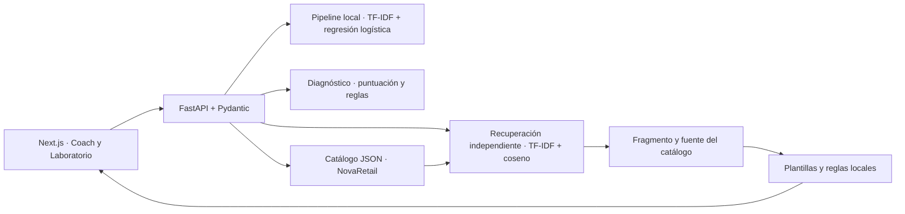

# Arquitectura de SkillFlow AI

## Componentes

El navegador llama a FastAPI usando `NEXT_PUBLIC_API_URL`. La lista de orígenes permitidos se configura con `CORS_ORIGINS`. Clasificación, recuperación, respuestas y creación de procedimientos funcionan localmente, sin API externa de IA. FastAPI genera OpenAPI desde los modelos Pydantic.

| Componente | Responsabilidad |
|---|---|
| `apps/web/app` | Pantallas App Router, incluida la interfaz de AI Coach y Laboratorio |
| `apps/web/components/demo-state.tsx` | Perfil, finalizaciones, última evaluación y consultas por perfil |
| `apps/web/lib/api.ts` | Tipos, peticiones, cancelación, timeout y manejo de errores |
| `routers/intelligence.py` | Predicción, Coach y lectura de métricas |
| `routers/training.py` | Recetas, evaluación y catálogo |
| `services/nlp.py` | Carga única y predicción con `models/intent_classifier.joblib` |
| `services/catalog.py` | Catálogo, TF-IDF documental y recuperación por similitud coseno |
| `services/coach.py` | Respuesta con fragmento/fuente, regla de plazo y abstención |
| `services/assessment.py` | Puntuación, debilidades y recomendaciones mediante reglas |
| `services/admin.py` | Estructura determinista de procedimientos nuevos |
| `services/workflows.py` | Aportaciones y aplicaciones persistidas en SQLite |

## Flujo del AI Coach

1. FastAPI valida y recorta la consulta. El clasificador cargado al iniciar devuelve la intención y puntuaciones `predict_proba`; son estimaciones no calibradas, no certezas.
2. De manera independiente, el recuperador compara la consulta con los procedimientos del catálogo y devuelve hasta tres documentos con similitud coseno de 0,16 o superior. La intención no excluye documentos candidatos.
3. El Coach construye una respuesta local con una plantilla que incluye el fragmento principal. Para el plazo de devolución, una regla compara los días detectados en la consulta contra el límite del fragmento.
4. Se muestran las fuentes usadas. Si no hay evidencia sobre el umbral, la API declara contexto insuficiente en vez de inventar una respuesta.
5. Se recomienda una receta recuperada. Para candidatos casi empatados, una regla puede preferir la categoría correspondiente a la intención.

`POST /api/classify` devuelve consulta, etiqueta, puntuaciones y nombre del modelo. `POST /api/coach` devuelve consulta, intención, documentos con scores, respuesta, fuentes, modo y recomendación. El Laboratorio obtiene métricas, reporte, matriz y comparación contra `DummyClassifier` desde `GET /api/model/metrics`.

## Diagnóstico, administración y estado

El servidor valida que se haya respondido exactamente a los nueve IDs del diagnóstico. Calcula aciertos por categoría y vincula categorías débiles con recetas. El navegador guarda los resultados de perfiles de demostración en `localStorage`.

El catálogo inicial se lee de JSON. Crear una receta divide el texto de entrada en pasos deterministas; no usa clasificación ni una API externa. Agregar una receta reconstruye el índice documental bajo un bloqueo y conserva una instantánea completa para lectores concurrentes. Los cambios directos duran mientras vive el proceso. El despliegue documentado usa una sola réplica.

La sesión 1 a 1 clasifica el ticket con el mismo endpoint local y permite confirmar o corregir la intención. `services/workflows.py` guarda aportaciones y aplicaciones en SQLite. El trabajo guiado y la biblioteca interna funcionan localmente; las tarjetas de industria enlazan a publicaciones externas como referencias, no como fuentes de generación de respuestas.
